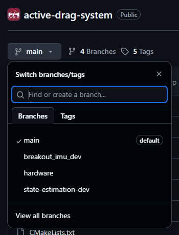

## So, What Actually *is* Git?
Git is a protocol invented by Linus Torvalds over 20 years ago originally for the development of the Linux kernel. What it *does* is provide a form of **version control** - i.e., a way to control the *versions* of some piece of software you're working on, and a method for integrating together changes made by multiple people at once. This is fantastic for teams like us, with many developers all working on the same codebase at once; there's a reason why according to the [stackoverflow developer survey](https://survey.stackoverflow.co/2022/#version-control-version-control-system), `git` is used and preferred by over 93% of developers worldwide.

Notably, `git` is just the *protocol* for managing version control - if you want to actually *store* the output of it somewhere (read: a shared remote repository), you'll need to either host one yourself, or use a third party service. The most common of these vendors is Github, a service provided by a company now owned by Microsoft. There are alternatives such as Gitlab that are better suited for industrial applications, but for our case, Github works fine.

## How Does It Work?
The main concept to wrap your head around to understand git is that of the *working tree* - a datastructure that represents your codebase, and all the work that has been done to it. Each git "**repository**" represents a working tree, with a variable number of "**branches**" that likely have different changes on them. The "repository" itself, to temporarily handwave some nuance, is just a directory containing files that you want to track over time. You can tell if a directory is a git repository by checking for hidden files within it - a git repo will always have a `.git` hidden directory, usually have a `.gitignore` file to tell it which files/directories *not* to track, and sometimes a `.gitmodules` file to define which submodules are included in the repo (more on that later). The `active_drag_system` repository has all three of these:
```bash
> pwd
/home/username/active_drag_system
> ls -lah
.  ..  build  CMakeLists.txt  .git  .gitignore  .gitmodules  hardware  include  LICENSE  notes.txt  README.md  src  tools
>_
```
If we look in the `.git` subdirectory, we'll find that it contains all of `git`'s internal files for tracking the working tree of the repository; generally, you won't have to touch any of this, as `git` will handle it all for you automatically in the backend when you run commands.
```bash
> ls .git
branches        config       FETCH_HEAD  hooks  info  modules  ORIG_HEAD    REBASE_HEAD
COMMIT_EDITMSG  description  HEAD        index  logs  objects  packed-refs  refs
```

The `.gitignore` file is very simple - it is quite literally a verbatim list of exactly which files and subdirectories within the repository *not* to track. Note the usage of wildcards (`*`) here - a wildcard following a subdirectory indicates to ignore *anything* in that directory, while a wildcard followed by a file extension indicates to ignore *any* file with that extension.
```bash
> cat .gitignore
Testing/*
.DS_Store
.vagrant/*
.idea/
.vscode/
CMakeFiles/
cmake_install.cmake
CMakeCache.txt
Makefile
src/CMakeFiles
src/cmake_install.cmake
src/Makefile
build/*

# For PCBs designed using KiCad: https://www.kicad.org/
# Format documentation: https://kicad.org/help/file-formats/

# Temporary files
*.000
*.bak
*.bck
*.kicad_pcb-bak
*.kicad_sch-bak
*-backups
*.kicad_prl
*.sch-bak
*~
_autosave-*
*.tmp
*-save.pro
*-save.kicad_pcb
fp-info-cache
~*.lck
\#auto_saved_files#

# Netlist files (exported from Eeschema)
*.net

# Autorouter files (exported from Pcbnew)
*.dsn
*.ses

# Exported BOM files
*.xml
*.csv
>_
```

Finally, the `.gitmodules` file is where the repository recognizes all of the submodules, which are what you're initializing by calling `git submodule update` before running any build processes.

```bash
> cat .gitmodules
[submodule "include/pico-sdk"]
	path = include/pico-sdk
	url = https://github.com/raspberrypi/pico-sdk
[submodule "include/eigen"]
	path = include/eigen
	url = https://gitlab.com/libeigen/eigen.git
[submodule "include/pico-logger"]
	path = include/pico-logger
	url = https://github.com/rocketryvt/pico-logger.git
[submodule "include/FreeRTOS-Kernel"]
	path = include/FreeRTOS-Kernel
	url = https://github.com/FreeRTOS/FreeRTOS-Kernel.git
[submodule "include/libfixmath"]
	path = include/libfixmath
	url = https://github.com/PetteriAimonen/libfixmath.git
[submodule "include/libfixmatrix"]
	path = include/libfixmatrix
	url = https://github.com/PetteriAimonen/libfixmatrix.git
[submodule "include/libfixkalman"]
	path = include/libfixkalman
	url = https://github.com/sunsided/libfixkalman.git
>_
```

Now, the other notable thing about a working *tree* is that it usually has *branches*. The main one of these is called, well, `main` - this is where the "core" version of whatever software you're keeping track of exists, and usually isn't directly changed too often. Rather, changes are made on their own *separate* branches, usually named something related to the changes being made to that version of the code. When ready, if the team agrees that changes on a branch are ready and stable, they'll be "merged" into main via a *merge request*. These are visible on the GitHub website, simply by clicking the dropdown on `main`.




//THIS PAGE UNDER CONSTRUCTION, SEE MEETING SLIDES FOR USAGE DOCS FOR NOW
## How Do I Use It? - GitHub Desktop

## How Do I Use It? - Git Bash