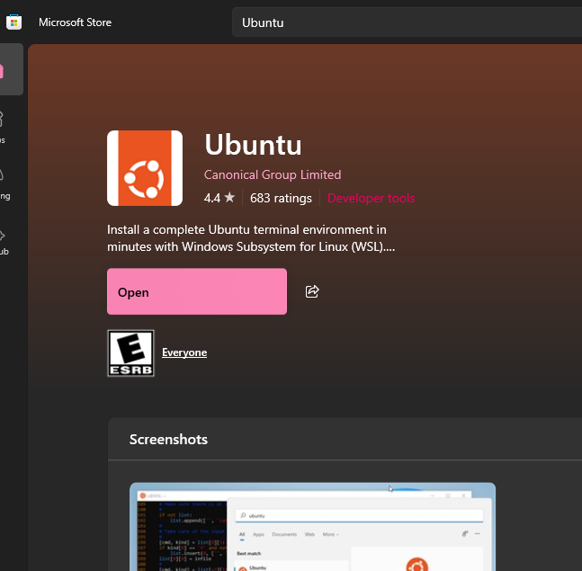
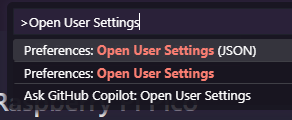
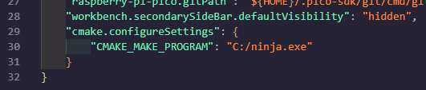
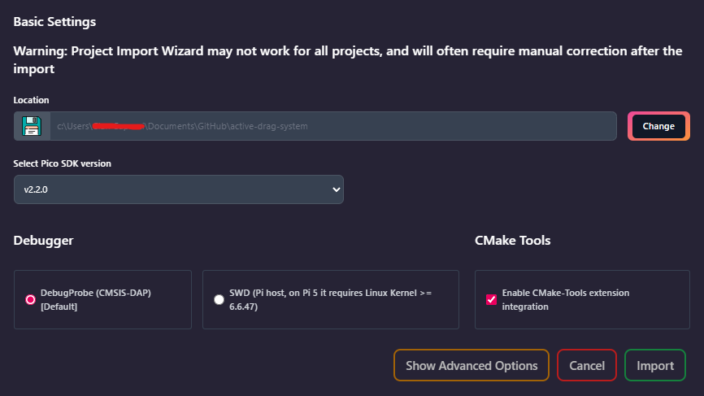
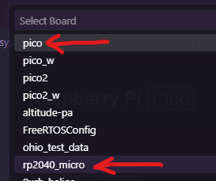

## Intro: Punching Through Menus
According to [statcounter](https://gs.statcounter.com/os-market-share/desktop/worldwide/#monthly-202502-202502-bar), Windows makes up just under 71% of all global desktop operating systems. And, frankly, there's good reason for it; in most cases, software that you'll find on the internet will "just work" in a format that's designed for Windows, whether it's gaming on steam, development in Visual Studio, or any of the MS Office software that we all know and... may or may not love.

The trade-off to this is that a lot of the underlying things that make the OS run - which for *our* specific case (very nitty-gritty embedded development) we need access to - are obfuscated behind many layers of menus or proprietary software licensed by Microsoft. Instead of a `bash` terminal, windows has `powershell`. Instead of a single `PATH` variable, there is a registry that needs to be edited. These differences make it very difficult to expose the library code that our compilers need access to - so we'll need to use a couple bits third-party software that integrates it for us to gain access to said code.

## GitHub Desktop 
To work with `git` natively, we recommend the use of [GitHub Desktop](https://desktop.github.com/download/), as it simplifies working with the protocol significantly for our purposes. As it's explained in detail in the `Git/GitHub` tab on the left, we won't include a full guide to its usage here for brevity; we'll assume you have GitHub Desktop or some other method of using `git` installed, and have a repository cloned on your computer that you're ready to develop on.
## WSL Guide
There are a couple of commands, mainly for working with `git`, that we'll need to run in a native `bash` terminal; to do this, we'll need to install a "distro" of Linux into the Windows Subsystem for Linux, or WSL. Notably, as the primary reason for doing this is to get direct commandline `git` access, if you have some other means of accessing it such as the [Git for Windows](https://gitforwindows.org/) toolkit, then you can skip this step and use it instead whenever a step says to open a WSL terminal.

1. Open a `command prompt` window, and type and enter `wsl --install`. This may take several minutes.
2. Once the above is complete, reboot your laptop for WSL to be enabled.
3. Now, go to the Microsoft Store, and look up and install `Ubuntu` - there will likely be several versions, it should work with any of them. This is the "distro" of Linux you're installing.

4. With `Ubuntu` installed, type it into the Windows start menu to open a new instance of it. It will prompt you for a username and password - every time you open `Ubuntu` beyond this, it will require this password.
5. Finally, in your terminal, enter the following commands. This will install `git` into your WSL instance (after prompting you for a password), and thus, you'll be ready to use it for development!
```bash
sudo apt update
sudo apt install git
```

## VSCode + Extensions Guide
Thankfully for our sake, the Raspberry Pi foundation recognized that trying to configure all of the backend things for development on Windows was a nightmare, and they bundled all of it into a single VSCode extension. It should be able to intake any existing `cmake` project (i.e. one of our repos), and configure all of the necessary flags internally to compile it as is necessary for development. There's a *little* bit of finnicky backend configuration, but it's *significantly* easier than the WSL method.

1. If you don't already have it, download and install [VSCode](https://code.visualstudio.com/docs/setup/windows) on your device. 
2. Once you have VSCode installed, head to the `Extensions` browser. Search for and install the following three extensions:
	1. Raspberry Pi Pico, by Raspberry Pi
	2. CMake Tools, by Microsoft
	3. Serial Monitor, by Microsoft
3. Use `CTRL + SHIFT + P` in VSCode to open the Command Palette, then type in and select `Open User Settings (JSON)` - then scroll to the bottom of the file that just opened.

4. Add a comma to the end of the last indented line of that settings file, and add the following config block to your user settings; for now, leave `CMAKE_MAKE_PROGRAM` empty, as we'll put a value there shortly.
```json
"cmake.configureSettings": {
    "CMAKE_MAKE_PROGRAM": ""
}
```
5. Download [ninja](https://github.com/ninja-build/ninja/releases) for Windows from its Github - this program will handle `cmake` on the backend, so you don't have to. Unzip the folder you downloaded somewhere, and move the `ninja.exe` file inside it to somewhere you'll remember it.
6. Left click the `ninja.exe` executable to highlight it in File Explorer, then *shift* right click it (thanks Windows), and click `Copy as path`. Then, paste the path you just copied into the `CMAKE_MAKE_PROGRAM` variable you just added - the end result should look something like this. (For this example, `ninja.exe` was just placed directly in the `C:\` drive.)


With that done, you should be ready to import your repository and work on it!

## Workflow Guide: Setup
For development on Windows, thankfully, almost the entire development process can be done natively in VSCode, barring a few first time setup things. This last section will break down all the steps for first time configuration of a newly cloned repository, and then the normal workflow steps to compile, upload, and test your code on a board within VSCode. Let's start with the first time configuration guide; for this writing, we'll use `active_drag_system` as an example.

1. If you haven't already, clone a repository that you'd like to work on, and change to the appropriate branch. This can be done via whatever means are most convenient to you, most likely GitHub Desktop.
2. Once you have the repository cloned, open its directory in file explorer. Shift right click on the "background space" without any files, and click `Open Linux terminal here` - this will open a WSL terminal directly to where you were in file explorer, and may take a second to boot.
3. In WSL, type and enter `git submodule update --init --recursive`. This will internally initialize all the submodules necessary for the code to build, and cannot be done in GitHub Desktop. Once this is done, you can close the WSL window.
4. Now, open VSCode, and enter the Raspberry Pi Pico extension you installed earlier. Click on the menu option that says `Import Project` - we're about to do exactly what it says on the tin.
5. Inside the new tab that just opened, click `change` on the `Location` box, and select the repository directory - in this case, `active_drag_system`. All of the other options should be fine left as defaults, with one exception: **click the checkbox that says `Enable CMake-Tools extension integration`**. Click `Import` once completed.

6. Finally, select which board you'll be uploading your code to by clicking `Switch Board` in the Pico extension. The dialog box that pops up will provide many options, some internal and some defined by us; select the one for whichever board you'll be uploading to, usually `pico` (a standard Pico 1) or `rp2040_micro` (an ADS PCB, as defined in that header file). If it prompts you for `RISC-V Usage`, click `No`. Once this is done, you're ready to debug!


## Workflow Guide: Usage
With all the setup things out of the way, we're down to what you're actually here for - compiling, uploading, and debugging your code! Thankfully, this stage is *very* simple now that we've gotten all of the setup things out of the way; at this point, you should be able to open VSCode at any time and immediately be ready to compile and test. 

- To *compile* your code, simply click the `Compile` button on the right side of the bottom status bar, or click `Compile Project` in the options under the Pico extension. This will open a terminal window inside VSCode at the bottom, and show you the real-time output of the process.
- To *upload* your code, first, unplug whatever board you're using, and plug it in **with the `BOOTSEL` button held down** to boot it into upload bode. Then, simply click the `Run` button to the right of the `Compile` button, or click the `Run Project (USB)` button in the Pico extension. This will compile your code, then upload it automatically via `picotool`.
- To *debug* your code, click on the `SERIAL MONITOR` tab of the bottom box that opened during the upload process to open the extension. Inside it, select the COM port that the board has opened - the easiest way to determine this if there are multiple is to unplug it, and see which one disappears. Select the `Toggle Terminal Mode` button (the one with a lil' shell icon on it) as depicted below, and then click `Start Monitoring` - this should give you a full interactive serial terminal with the board, right inside VSCode!


Note that should you want to use a non-inside VSCode serial monitor, there are several other options. The easiest to use is [PuTTY](https://www.chiark.greenend.org.uk/~sgtatham/putty/latest.html), which simply requires opening the right "Serial" port type after plugging in the board of your choice.

